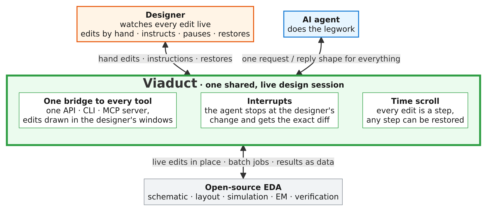

# Code a Chip Together, with Viaduct: A Designer and an AI Agent in One Live EDA Session.

https://github.com/user-attachments/assets/1a8d281a-3c4f-4f4e-a3f9-29e1dfef8f9f

[Open the executed notebook](viaduct_code_a_chip.executed.ipynb)

| Name                    | Affiliation                                                                                   | IEEE Member | SSCS Member | Email                 |
|:-----------------------:|:---------------------------------------------------------------------------------------------:|:-----------:|:-----------:|:---------------------:|
| Supeng AXi*             | Institute of Microelectronics, A*STAR, Singapore; Nanyang Technological University, Singapore | Yes         | No          | axis0001@e.ntu.edu.sg |
| Jinhai Hu* (Leader)     | Institute of Microelectronics, A*STAR, Singapore                                              | Yes         | Yes         | hujh@a-star.edu.sg    |
| Zhishuai Zhang          | ETH Zürich, Switzerland                                                                       | Yes         | Yes         | zzhishuai@ethz.ch     |
| Wang Ling Goh (Advisor) | Nanyang Technological University, Singapore                                                   | Yes         | Yes         | ewlgoh@ntu.edu.sg     |
| Yuan Gao (Advisor)      | Institute of Microelectronics, A*STAR, Singapore                                              | Yes         | Yes         | gaoy@a-star.edu.sg    |

**Viaduct is, to our knowledge, the first unified bridge that brings an AI agent into
open-source EDA Tools with an open-source PDK in the designer's live GUI session.**
It lets the agent orchestrate schematic design, simulation, layout, extraction and
verification through one interface, with structured results connecting each step.
Viaduct utilizes
[IIC-OSIC-TOOLS](https://github.com/iic-jku/iic-osic-tools), whose maintainers and
contributors make this integrated workflow possible.

**The key innovation is continuous collaboration during design, not just a result
at the end.** In many agent-assisted circuit-design workflows, the designer sees
completed outputs but has little visibility into a long optimization run. It can
be hard to tell how far the agent has progressed or whether it is pursuing a
misguided approach, and intervening may mean restarting the work. Viaduct makes
the work visible as it happens in the open-source EDA Tools GUI that the designer
already uses, so the designer can inspect progress and steer the agent while it
works.

The shared interface supports live instructions, hand edits, pause/resume and
restoration of earlier design states. Each edit becomes a restorable step in the
**time scroll**. When the designer intervenes, the agent receives the exact change,
acknowledges it and continues from the updated design with its remaining plan.
Coordinated edits protect the designer's changes and let both collaborators work
in one session without overwriting each other's work. The **cockpit** brings the
live desktop, progress, instructions and history together.

In real IC design the designer is indispensable: specifications, topology,
trade-offs, layout intent and sign-off are decisions that need judgement and
someone accountable for them. Viaduct does not try to replace the designer. It
brings the AI into the live open-source EDA Tools GUI that the designer is already
using, hands the legwork to the AI and leaves the judgement with the designer.

**In one line: the AI is a colleague working on your screen next to you, not a black
box that works behind a closed door and hands back a pile of files at the end.**

This ISSCC 2027 Code-a-Chip submission includes the executed notebook and runtime
source files for three case studies: a five-transistor OTA, a two-stage op amp,
and T-coil bandwidth extension with EM extraction.



## What Viaduct can do

| Area | What the agent can do |
|---|---|
| Layout (KLayout) | Open or create layouts, place the T-coil PCell and change its parameters in place, add shapes and labels, write EM results onto the cell (with their run ID), take screenshots. Edits appear live; a batch of edits is one undo step. |
| Schematic (xschem) | Create or modify schematics, place SKY130 symbols, wire instance pins to each other by name, attach net labels, read back the real connectivity, check for floating pins and single-pin nets, netlist. |
| Simulation (ngspice) | Simulate a netlist or the schematic that is open, return AC / transient metrics, report the operating point and region of every transistor, sweep parameters in one run, draw the waveforms on the schematic. |
| EM extraction | FastHenry: L, R, Q and coupling k of the coil. FasterCap: parasitic capacitance with a SPICE π-model. Palace: full-wave cross-check including substrate loss and self-resonance. |
| Verification | SKY130 DRC (community KLayout deck) of the open layout, with the markers shown in KLayout. |
| Closed loop | T-coil bandwidth extension end to end: schematic → simulate → size the coil → layout → extract → re-simulate with the extracted coil (`examples/tcoil_amp_closed_loop.py`). |
| Designer in the loop | Every edit becomes a time-scroll step (snapshot + screenshot, actor agent / designer); restore any step. The designer interrupts with an instruction (with their selection), a pause, a restore or a hand edit in the window; the agent's next edit returns `INTERRUPTED` with the exact change and its saved plan, and a schematic the designer edited cannot be rebuilt over. |
| Cockpit | `client.py cockpit`: one local page with the noVNC desktop, the session state, an interrupt box, pause / resume, the agent's plan and the time scroll with restore. |
| Safety and traceability | Dialogs belong to the designer and are never closed automatically; every request has an ID whose outcome can be looked up later; replies are signed; every request is audited; safe mode turns off raw code execution. |
| Ways in | Python API, command line, MCP server for agents, and a headless mode for notebooks and CI. |


## Architecture

```text
Agent / notebook -- Python API / CLI / MCP -- relay
Designer --------- cockpit ------------------|   history, interrupts, receipts, audit
                                            |-- KLayout tap: live layout and PCells
                                            |-- xschem tap: live schematics and connectivity
                                            |-- ngspice: simulation and operating points
                                            |-- FastHenry / FasterCap: coil L, R, Q, k and C
                                            |-- Palace: optional full-wave cross-check
                                            `-- KLayout DRC: SKY130 community deck
```

The taps run inside the tools' GUI event loops. Live mode edits the designer's
windows; headless mode uses a separate Xvfb display with its own ports and session
state. Both modes expose the same API.

## Notebook case studies

| Part | Circuit or task | What to look for |
|---|---|---|
| A | Five-transistor OTA | Hand edits, instructions with a selection, pause/resume, rebuild protection and restoration from the time scroll |
| B | Two-stage Miller op amp | A two-device hand edit during a compensation sweep, rejection of stale sweep results, selection-based instructions and back/forward restoration |
| C | T-coil bandwidth extension | Parameterized layout, EM extraction, community-deck DRC, ideal-to-extracted circuit comparison and an archived full-wave cross-check |

Part A begins with the live desktop video. The notebook then scripts both the agent
and the designer in headless mode so that the interactions can be reproduced.
Part B records the design history as screenshots and checks eight interaction
behaviors. Part C includes an ideal T-coil model with optional interactive sliders.

## Designer control and traceability

Every successful design edit creates a time-scroll step containing the design state,
a screenshot and its actor. Restoring a step first records the state being replaced.
A hand edit, instruction or restore interrupts the agent; its next edit is refused
with the relevant changes and its saved plan until it acknowledges the interruption.
A pause continues to block edits until the designer resumes. A rebuild guard protects
schematics the designer has edited.

The cockpit places the desktop, instructions, pause/resume controls, agent plan and
time scroll together. Tool calls also provide request IDs, result receipts and an
audit trail. Replies are signed, safe mode restricts raw evaluation, and blocking
dialogs are reported for the designer to handle.

## Results in the executed notebook

Part B plots the compensation sweep, identifies a candidate meeting the designer's
phase-margin target, and reports its gain, unity-gain frequency, bias and checks
alongside the saved design history. See the executed outputs for the full record.

The T-coil closed loop compares the same driver with ideal and extracted coils:

| Case | Bandwidth | Relative to baseline |
|---|---|---|
| No T-coil | 16.3 GHz | 1.00x |
| Ideal T-coil | 40.6 GHz | 2.50x |
| Extracted L+C, P2 at drain | 26.5 GHz | 1.63x |
| Extracted L+C, P2 at drain, extra 20 fF bridging capacitor | 29.9 GHz | 1.84x |

These are saved simulation results, not new measurements. The comparison run is
`20261029_110944_2414`, archived in the notebook; the original generated report
was under `runs/closedloop_20261029_110951/`. The coil uses FastHenry quasi-static
L/R/k and FasterCap capacitances; the ideal case uses lumped inductors and coupling.
The reported DRC result is clean against the SKY130 community deck (256 rules),
run `20261029_110829_182e`, originally under `runs/drc_20261029_110829_182e/`.

## View the submission

Open `viaduct_code_a_chip.executed.ipynb` to read the notebook with its saved outputs.
The HTML reading copy is `viaduct_code_a_chip.html`.
The live-session demonstration is `viaduct_code_a_chip_together.mp4`.

## Reproduce

Use the IIC-OSIC-TOOLS 2026.08 environment used by the notebook. Recorded versions are
KLayout 0.30.11, xschem 3.4.8RC, ngspice 47, FastHenry 3.0.1, FasterCap 6.0.7 and
Python 3.12.3, with the SKY130 PDK. Jupyter, NumPy and Matplotlib are required;
ipywidgets enables the optional interactive controls.

Mount this `Viaduct` directory inside the container at `/foss/designs/viaduct`.
The unchanged runtime and notebook use this container path. Run commands in the
IIC-OSIC-TOOLS container with its tools and PDK environment configured:

```bash
cd /foss/designs/viaduct
jupyter lab
```

Open `viaduct_code_a_chip.executed.ipynb` and run all cells. The notebook starts a
separate headless EDA session; use a fresh container/session for reproduction.
Generated schematics, simulation results and history are created during execution.
Part A and Part B include scripted designer actions to exercise the interaction mechanism.

C4 defaults to `RUN_FULLWAVE = False` and reads the two included files under
`docs/fullwave/`. An optional full-wave rerun requires AWS Palace, gds2palace and
their dependencies, including scikit-rf for result processing. Keep the default
to reproduce the archived full-wave comparison without a new Palace run.

To export the existing notebook outputs as HTML without rerunning simulations:

```bash
jupyter nbconvert --to html viaduct_code_a_chip.executed.ipynb --output viaduct_code_a_chip
```

For the live desktop interface shown in the video, run `python client.py start`
and `python client.py cockpit` in the configured environment.
The project-local `.mcp.json` starts the MCP server with
`python -m viaduct.mcp_server`; launch your agent from this directory with the
Viaduct Python environment available. `AGENTS.md` and `skills/` contain its
working rules and per-tool instructions.

## Submission contents

```text
README.md                          Submission overview and reproduction instructions
viaduct_code_a_chip.executed.ipynb   Executed notebook with saved outputs
viaduct_code_a_chip.html             HTML reading copy with saved outputs
viaduct_code_a_chip_together.mp4 Live designer/agent interaction video
AGENTS.md                          Working rules for coding agents
skills/                            Per-tool instructions used by agents
.mcp.json                          Project-local MCP server configuration
.gitignore                         Generated runs and local-state exclusions
client.py                          Command-line entry point
viaduct/                           Python API, transport, CLI, MCP and cockpit
container/                         Relay, history, interrupts and simulation runners
taps/                              In-process KLayout and xschem integrations
devices/tcoil/                     T-coil geometry and KLayout PCell
pdk/                               SKY130 layer and stack profiles
examples/                          The three circuit builders used by the notebook
docs/viaduct_overview.png          Designer/agent workflow diagram
docs/fullwave/                     Archived comparison data and plot used by C4
LICENSE                            Apache-2.0 license
pyproject.toml                     Python package metadata
```

The runtime generates its own `runs/`, `xschem/` and session-state directories.

## License

Apache-2.0; see `LICENSE`. External EDA tools and PDKs retain their own licenses.

## Acknowledgement

This work is supported by the Agency for Science, Technology and Research (A*STAR), Singapore under the Semiconductor RIE Flagship Programme (Integrated Circuit Design & Systems), grant No. H26-MSE1535.

We thank the maintainers and contributors of
[IIC-OSIC-TOOLS](https://github.com/iic-jku/iic-osic-tools) for providing the
open-source IC design environment that supports Viaduct's development and demonstrations.
